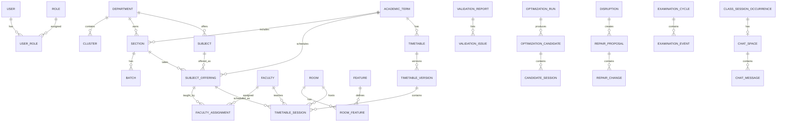

# Database Schema
## BMSCE Smart Academic Management & Timetable System

**Version:** 1.0  
**Database:** PostgreSQL  
**ORM recommendation:** Prisma  
**Status:** Proposed logical schema  
**Data policy:** Synthetic-first

## 1. Design principles

- PostgreSQL is the canonical source of truth.
- Published timetable versions are immutable.
- Draft edits use optimistic concurrency control.
- Dated schedule exceptions represent one-off changes without rewriting the recurring published timetable.
- Solver input/configuration and outputs are recorded for reproducibility.
- Independent validation is stored separately from solver score/status.
- Access is scoped by role and academic unit.
- Use UTC for timestamps and `Asia/Kolkata` for BMSCE display.
- Mark synthetic data explicitly; never present it as official institutional data.

## 2. Entity groups

1. Identity and authorization.
2. Academic structure.
3. Calendar and scheduling configuration.
4. Faculty and room resources.
5. Timetable drafts, versions, sessions, and exceptions.
6. Optimization runs, candidates, and validation.
7. Disruptions and repair proposals.
8. Class communication and notifications.
9. Examination scheduling.
10. Audit and data import.

## 3. ER overview

## 4. Conventions

- Primary keys: UUID.
- Timestamps: `timestamptz`.
- Use enums/check constraints for stable statuses and categories.
- Use JSONB for versioned snapshots, metrics, and diagnostics—not for core relational entities.
- Index foreign keys and common filters.
- Use `created_by_id`/`updated_by_id` where accountability matters.
- Avoid cascading deletes for audit, published schedules, approvals, and historical records.

## 5. Identity and authorization

### `users`
- `id UUID PK`
- `institutional_email CITEXT UNIQUE NULL`
- `display_name VARCHAR(160) NOT NULL`
- `auth_provider VARCHAR(40) NOT NULL` (`DEMO`, `OIDC`, etc.)
- `provider_subject VARCHAR(255) NULL`
- `status VARCHAR(20)` (`ACTIVE`, `INVITED`, `DISABLED`)
- `is_demo BOOLEAN DEFAULT false`
- `last_login_at TIMESTAMPTZ NULL`
- `created_at`, `updated_at`

Do not treat email-domain matching alone as identity verification.

### `roles`
- `id UUID PK`
- `code VARCHAR(40) UNIQUE` (`STUDENT`, `FACULTY`, `CR`, `DEPT_HEAD`, `CLUSTER_HEAD`, `PLATFORM_ADMIN`)
- `name VARCHAR(100)`
- `description TEXT NULL`

### `user_roles`
- `id UUID PK`
- `user_id UUID FK users`
- `role_id UUID FK roles`
- `department_id UUID FK departments NULL`
- `cluster_id UUID FK clusters NULL`
- `section_id UUID FK sections NULL`
- `valid_from DATE NULL`
- `valid_until DATE NULL`
- `created_at TIMESTAMPTZ`

Prevent overlapping/ambiguous active assignments in application logic.

### `students`
- `id UUID PK`
- `user_id UUID UNIQUE FK users`
- `section_id UUID FK sections`
- `batch_id UUID FK batches NULL`
- `demo_identifier VARCHAR(50) NULL`
- `status VARCHAR(20)`

Do not add marks or attendance fields to this product schema.

### `faculty`
- `id UUID PK`
- `user_id UUID UNIQUE FK users`
- `department_id UUID FK departments`
- `employee_code VARCHAR(50) NULL`
- `designation VARCHAR(100) NULL`
- `cabin_location VARCHAR(100) NULL`
- `is_demo BOOLEAN DEFAULT false`
- `status VARCHAR(20)`

Use fictional people and identifiers in demo seeds.

## 6. Academic structure

### `departments`
- `id UUID PK`
- `code VARCHAR(30) UNIQUE`
- `name VARCHAR(160)`
- `is_demo BOOLEAN DEFAULT false`
- timestamps

### `clusters`
- `id UUID PK`
- `department_id UUID FK departments`
- `code VARCHAR(30)`
- `name VARCHAR(160)`
- Unique `(department_id, code)`

### `academic_terms`
- `id UUID PK`
- `academic_year_label VARCHAR(30)` (e.g. `DEMO-2026-27`)
- `term_label VARCHAR(60)`
- `start_date DATE`
- `end_date DATE`
- `timezone VARCHAR(60) DEFAULT 'Asia/Kolkata'`
- `status VARCHAR(20)` (`DRAFT`, `ACTIVE`, `COMPLETED`, `ARCHIVED`)
- `is_demo BOOLEAN DEFAULT true`
- timestamps
- Check `start_date <= end_date`.

### `programs`
- `id UUID PK`
- `department_id UUID FK departments`
- `code VARCHAR(30)`
- `name VARCHAR(160)`
- `degree_level VARCHAR(40) NULL`

### `sections`
- `id UUID PK`
- `department_id UUID FK departments`
- `cluster_id UUID FK clusters NULL`
- `program_id UUID FK programs`
- `academic_term_id UUID FK academic_terms`
- `semester_number SMALLINT`
- `section_code VARCHAR(30)`
- `display_name VARCHAR(100)`
- `student_count INTEGER`
- `status VARCHAR(20)`
- Unique `(academic_term_id, program_id, semester_number, section_code)`

### `batches`
- `id UUID PK`
- `section_id UUID FK sections`
- `batch_code VARCHAR(30)`
- `display_name VARCHAR(100)`
- `student_count INTEGER`
- Unique `(section_id, batch_code)`

### `subjects`
- `id UUID PK`
- `department_id UUID FK departments`
- `subject_code VARCHAR(40)`
- `name VARCHAR(180)`
- `subject_type VARCHAR(30)` (`THEORY`, `LAB`, `TUTORIAL`, `PROJECT`, `OTHER`)
- `default_duration_periods SMALLINT NULL`
- `is_active BOOLEAN`
- Unique `(department_id, subject_code)`

### `subject_offerings`
Represents a subject taught to a section or batch in a term.
- `id UUID PK`
- `subject_id UUID FK subjects`
- `academic_term_id UUID FK academic_terms`
- `section_id UUID FK sections`
- `batch_id UUID FK batches NULL`
- `required_periods_per_week NUMERIC(5,2)`
- `session_duration_periods SMALLINT`
- `expected_student_count INTEGER`
- `requires_lab BOOLEAN`
- `requires_contiguous_slots BOOLEAN`
- `notes TEXT NULL`

Validate that section and term match; batch must belong to section.

### `faculty_assignments`
- `id UUID PK`
- `subject_offering_id UUID FK subject_offerings`
- `faculty_id UUID FK faculty`
- `assignment_type VARCHAR(30)` (`PRIMARY`, `CO_TEACHER`, `SUBSTITUTE_ELIGIBLE`)
- `max_periods_per_week NUMERIC(5,2) NULL`
- `valid_from DATE NULL`
- `valid_until DATE NULL`
- `status VARCHAR(20)`

## 7. Calendar and scheduling configuration

### `academic_calendar_events`
- `id UUID PK`
- `academic_term_id UUID FK academic_terms`
- `event_date DATE`
- `event_type VARCHAR(30)` (`HOLIDAY`, `WORKING_DAY`, `EXAM`, `EVENT`, `OTHER`)
- `title VARCHAR(160)`
- `description TEXT NULL`
- `is_instructional BOOLEAN DEFAULT false`

### `bell_schedules`
- `id UUID PK`
- `academic_term_id UUID FK academic_terms`
- `name VARCHAR(100)`
- `effective_from DATE`
- `effective_until DATE NULL`
- `is_default BOOLEAN`

### `time_periods`
- `id UUID PK`
- `bell_schedule_id UUID FK bell_schedules`
- `period_number SMALLINT`
- `label VARCHAR(40)`
- `start_time TIME`
- `end_time TIME`
- `period_type VARCHAR(20)` (`CLASS`, `BREAK`, `LUNCH`, `OTHER`)
- Unique `(bell_schedule_id, period_number)`
- Check `start_time < end_time`; validate period overlaps.

### `scheduling_constraint_profiles`
- `id UUID PK`
- `academic_term_id UUID FK academic_terms`
- `name VARCHAR(120)`
- `version INTEGER`
- `hard_constraints JSONB`
- `soft_weights JSONB`
- `assumptions JSONB`
- `created_by_id UUID FK users`
- `created_at TIMESTAMPTZ`

Snapshot profile settings into every optimization run.

## 8. Faculty and room resources

### `faculty_availability`
- `id UUID PK`
- `faculty_id UUID FK faculty`
- `academic_term_id UUID FK academic_terms`
- `availability_type VARCHAR(20)` (`AVAILABLE`, `UNAVAILABLE`, `PREFERRED`)
- `day_of_week SMALLINT NULL` (1–7)
- `start_time TIME NULL`
- `end_time TIME NULL`
- `specific_date DATE NULL`
- `reason TEXT NULL`
- `created_by_id UUID FK users`

Represent either a recurring weekday window or a specific-date window; validate completeness.

### `faculty_workload_rules`
- `id UUID PK`
- `faculty_id UUID FK faculty`
- `academic_term_id UUID FK academic_terms`
- `max_periods_per_day SMALLINT NULL`
- `max_periods_per_week SMALLINT NULL`
- `max_consecutive_periods SMALLINT NULL`
- `min_break_periods SMALLINT NULL`
- `is_demo_assumption BOOLEAN DEFAULT true`

All rules configurable; do not assume BMSCE limits.

### `rooms`
- `id UUID PK`
- `department_id UUID FK departments NULL`
- `room_code VARCHAR(40)`
- `name VARCHAR(120)`
- `room_type VARCHAR(30)` (`CLASSROOM`, `LAB`, `AUDITORIUM`, `OTHER`)
- `capacity INTEGER`
- `location_label VARCHAR(160) NULL`
- `is_active BOOLEAN`
- `is_demo BOOLEAN DEFAULT false`

Define an appropriate uniqueness rule for room codes within department/global scope.

### `features`
- `id UUID PK`
- `code VARCHAR(40) UNIQUE`
- `name VARCHAR(100)`

### `room_features`
- `room_id UUID FK rooms`
- `feature_id UUID FK features`
- Composite PK `(room_id, feature_id)`

### `room_availability`
- `id UUID PK`
- `room_id UUID FK rooms`
- `academic_term_id UUID FK academic_terms`
- `availability_type VARCHAR(20)` (`AVAILABLE`, `UNAVAILABLE`)
- `day_of_week SMALLINT NULL`
- `specific_date DATE NULL`
- `start_time TIME`
- `end_time TIME`
- `reason TEXT NULL`

## 9. Timetable lifecycle and versioning

### `timetables`
- `id UUID PK`
- `academic_term_id UUID FK academic_terms`
- `department_id UUID FK departments`
- `cluster_id UUID FK clusters NULL`
- `name VARCHAR(160)`
- `scope_type VARCHAR(30)` (`DEPARTMENT`, `CLUSTER`, `SECTION_GROUP`)
- `status VARCHAR(20)` (`DRAFT`, `ACTIVE`, `ARCHIVED`)
- `created_by_id UUID FK users`
- timestamps

### `timetable_versions`
- `id UUID PK`
- `timetable_id UUID FK timetables`
- `version_number INTEGER`
- `status VARCHAR(30)` (`DRAFT`, `IN_REVIEW`, `APPROVED`, `PUBLISHED`, `SUPERSEDED`, `REJECTED`)
- `source_type VARCHAR(30)` (`MANUAL`, `OPTIMIZER`, `REPAIR`, `IMPORT`)
- `optimization_candidate_id UUID NULL`
- `constraint_profile_snapshot JSONB`
- `validation_status VARCHAR(30)`
- `hard_violation_count INTEGER`
- `soft_penalty NUMERIC(14,4) NULL`
- `created_by_id UUID FK users`
- `approved_by_id UUID FK users NULL`
- `published_by_id UUID FK users NULL`
- `approved_at TIMESTAMPTZ NULL`
- `published_at TIMESTAMPTZ NULL`
- `supersedes_version_id UUID NULL FK timetable_versions`
- `change_summary TEXT NULL`
- `created_at TIMESTAMPTZ`
- Unique `(timetable_id, version_number)`

Published versions are immutable in application logic and database permissions.

### `timetable_sessions`
One recurring weekly session within a version.
- `id UUID PK`
- `timetable_version_id UUID FK timetable_versions`
- `subject_offering_id UUID FK subject_offerings`
- `faculty_id UUID FK faculty`
- `room_id UUID FK rooms`
- `section_id UUID FK sections`
- `batch_id UUID FK batches NULL`
- `day_of_week SMALLINT`
- `start_time TIME`
- `end_time TIME`
- `start_period_number SMALLINT NULL`
- `duration_periods SMALLINT`
- `session_kind VARCHAR(30)` (`LECTURE`, `LAB`, `TUTORIAL`, `PROJECT`, `OTHER`)
- `group_key VARCHAR(80) NULL`
- `created_at TIMESTAMPTZ`

Check valid day/time/duration. Cross-row overlap requires validation and may also use PostgreSQL exclusion constraints.

### `timetable_publications`
- `id UUID PK`
- `timetable_version_id UUID FK timetable_versions UNIQUE`
- `published_by_id UUID FK users`
- `published_at TIMESTAMPTZ`
- `publication_note TEXT NULL`
- `notification_batch_id UUID NULL`

### `schedule_exceptions`
Dated changes to a recurring published schedule.
- `id UUID PK`
- `timetable_version_id UUID FK timetable_versions`
- `original_session_id UUID FK timetable_sessions NULL`
- `exception_date DATE`
- `exception_type VARCHAR(30)` (`CANCEL`, `RESCHEDULE`, `SUBSTITUTE`, `ROOM_CHANGE`, `OTHER`)
- `replacement_faculty_id UUID FK faculty NULL`
- `replacement_room_id UUID FK rooms NULL`
- `replacement_start_time TIME NULL`
- `replacement_end_time TIME NULL`
- `status VARCHAR(20)` (`DRAFT`, `APPROVED`, `PUBLISHED`, `CANCELLED`)
- `reason TEXT`
- `approved_by_id UUID FK users NULL`
- `published_at TIMESTAMPTZ NULL`
- `created_by_id UUID FK users`
- `created_at TIMESTAMPTZ`

For complex changes involving multiple replacement sessions, add child rows. Never mutate the original recurring published session for a one-day change.

## 10. Optimization and validation

### `optimization_runs`
- `id UUID PK`
- `academic_term_id UUID FK academic_terms`
- `timetable_id UUID FK timetables NULL`
- `requested_by_id UUID FK users`
- `algorithm_code VARCHAR(40)` (`GREEDY`, `CP_SAT`, `LNS`, `SA`)
- `algorithm_version VARCHAR(60)`
- `solver_parameters JSONB`
- `input_snapshot JSONB`
- `input_hash VARCHAR(128)`
- `random_seed BIGINT NULL`
- `time_limit_seconds INTEGER`
- `status VARCHAR(30)` (`QUEUED`, `VALIDATING_INPUT`, `RUNNING`, `COMPLETED`, `FAILED`, `CANCELLED`, `TIMED_OUT`)
- `solver_status VARCHAR(30) NULL`
- `started_at TIMESTAMPTZ NULL`
- `completed_at TIMESTAMPTZ NULL`
- `runtime_ms BIGINT NULL`
- `failure_code VARCHAR(80) NULL`
- `failure_message TEXT NULL`
- `created_at TIMESTAMPTZ`

### `optimization_candidates`
- `id UUID PK`
- `optimization_run_id UUID FK optimization_runs`
- `candidate_number INTEGER`
- `label VARCHAR(120)`
- `solver_status VARCHAR(30)`
- `is_feasible BOOLEAN`
- `hard_violation_count INTEGER`
- `soft_penalty NUMERIC(14,4) NULL`
- `quality_score NUMERIC(8,4) NULL`
- `unscheduled_session_count INTEGER`
- `metrics JSONB`
- `explanation JSONB`
- `created_at TIMESTAMPTZ`
- Unique `(optimization_run_id, candidate_number)`

Feasibility must be based on independent validation, not solver status alone.

### `candidate_sessions`
- `id UUID PK`
- `optimization_candidate_id UUID FK optimization_candidates`
- `subject_offering_id UUID FK subject_offerings`
- `faculty_id UUID FK faculty`
- `room_id UUID FK rooms`
- `section_id UUID FK sections`
- `batch_id UUID FK batches NULL`
- `day_of_week SMALLINT`
- `start_time TIME`
- `end_time TIME`
- `duration_periods SMALLINT`
- `session_kind VARCHAR(30)`
- `group_key VARCHAR(80) NULL`

### `validation_reports`
- `id UUID PK`
- `target_type VARCHAR(30)` (`CANDIDATE`, `TIMETABLE_VERSION`, `REPAIR_PROPOSAL`, `EXAMINATION_CYCLE`)
- `target_id UUID`
- `validator_version VARCHAR(60)`
- `status VARCHAR(30)` (`PASSED`, `FAILED`, `WARNINGS`)
- `hard_violation_count INTEGER`
- `soft_warning_count INTEGER`
- `sessions_checked INTEGER`
- `runtime_ms BIGINT`
- `summary JSONB`
- `created_at TIMESTAMPTZ`

### `validation_issues`
- `id UUID PK`
- `validation_report_id UUID FK validation_reports`
- `severity VARCHAR(20)` (`HARD`, `SOFT`, `INFO`)
- `code VARCHAR(60)`
- `message TEXT`
- `entity_type VARCHAR(40) NULL`
- `entity_id UUID NULL`
- `related_entity_ids JSONB`
- `details JSONB`
- `created_at TIMESTAMPTZ`

## 11. Disruptions and repairs

### `disruptions`
- `id UUID PK`
- `academic_term_id UUID FK academic_terms`
- `reported_by_id UUID FK users`
- `disruption_type VARCHAR(40)` (`FACULTY_UNAVAILABLE`, `ROOM_UNAVAILABLE`, `CALENDAR_CHANGE`, `OTHER`)
- `affected_faculty_id UUID FK faculty NULL`
- `affected_room_id UUID FK rooms NULL`
- `affected_date DATE`
- `start_time TIME NULL`
- `end_time TIME NULL`
- `reason TEXT`
- `status VARCHAR(30)` (`OPEN`, `ANALYZING`, `PROPOSALS_READY`, `RESOLVED`, `REJECTED`, `CANCELLED`)
- timestamps

### `disruption_affected_sessions`
- `id UUID PK`
- `disruption_id UUID FK disruptions`
- `timetable_session_id UUID FK timetable_sessions`
- Unique `(disruption_id, timetable_session_id)`

### `repair_proposals`
- `id UUID PK`
- `disruption_id UUID FK disruptions`
- `strategy_code VARCHAR(40)` (`SUBSTITUTE_FACULTY`, `ALTERNATE_SLOT`, `ALTERNATE_ROOM`, `FREE_PERIOD`, `OTHER`)
- `status VARCHAR(30)` (`DRAFT`, `VALIDATING`, `VALID`, `INVALID`, `SUBMITTED`, `APPROVED`, `REJECTED`, `APPLIED`)
- `impact_metrics JSONB`
- `validation_report_id UUID FK validation_reports NULL`
- `created_by_id UUID FK users`
- `reviewed_by_id UUID FK users NULL`
- `review_comment TEXT NULL`
- `reviewed_at TIMESTAMPTZ NULL`
- `created_at TIMESTAMPTZ`

### `repair_changes`
- `id UUID PK`
- `repair_proposal_id UUID FK repair_proposals`
- `timetable_session_id UUID FK timetable_sessions`
- `change_type VARCHAR(30)` (`FACULTY`, `ROOM`, `TIME`, `CANCEL`, `ADD`)
- `old_values JSONB`
- `proposed_values JSONB`
- `created_at TIMESTAMPTZ`

Apply only after independent validation and authorized approval. Application creates dated exceptions or a new version.

## 12. Class communication

### `class_session_occurrences`
A dated occurrence derived from a recurring timetable session.
- `id UUID PK`
- `timetable_session_id UUID FK timetable_sessions`
- `session_date DATE`
- `effective_faculty_id UUID FK faculty`
- `effective_room_id UUID FK rooms`
- `effective_start_time TIME`
- `effective_end_time TIME`
- `status VARCHAR(20)` (`UPCOMING`, `OPEN`, `COMPLETED`, `CANCELLED`)
- Unique `(timetable_session_id, session_date)`

### `chat_spaces`
- `id UUID PK`
- `class_session_occurrence_id UUID FK class_session_occurrences UNIQUE`
- `opens_at TIMESTAMPTZ`
- `closes_at TIMESTAMPTZ`
- `status VARCHAR(20)` (`UPCOMING`, `OPEN`, `CLOSED`)
- `retention_until TIMESTAMPTZ NULL`
- `created_at TIMESTAMPTZ`

### `chat_members`
- `id UUID PK`
- `chat_space_id UUID FK chat_spaces`
- `user_id UUID FK users`
- `membership_role VARCHAR(30)` (`FACULTY`, `CR`, `STUDENT`)
- `can_send_messages BOOLEAN`
- Unique `(chat_space_id, user_id)`

### `chat_messages`
- `id UUID PK`
- `chat_space_id UUID FK chat_spaces`
- `sender_user_id UUID FK users`
- `message_type VARCHAR(20)` (`TEXT`, `ANNOUNCEMENT`, `SYSTEM`)
- `body TEXT`
- `is_important BOOLEAN DEFAULT false`
- `created_at TIMESTAMPTZ`
- `edited_at TIMESTAMPTZ NULL`
- `deleted_at TIMESTAMPTZ NULL`

Closed chat spaces reject new messages server-side. Important messages follow retention policy.

### `message_attachments`
- `id UUID PK`
- `message_id UUID FK chat_messages`
- `storage_key VARCHAR(500)`
- `original_filename VARCHAR(255)`
- `mime_type VARCHAR(120)`
- `size_bytes BIGINT`
- `scan_status VARCHAR(20)`
- `created_at TIMESTAMPTZ`

Store file bytes in controlled object storage, not the relational database.

### `faculty_cr_requests`
- `id UUID PK`
- `section_id UUID FK sections`
- `faculty_id UUID FK faculty`
- `created_by_id UUID FK users`
- `subject VARCHAR(180)`
- `body TEXT`
- `category VARCHAR(40)` (`SCHEDULE`, `CLASS`, `ANNOUNCEMENT`, `OTHER`)
- `status VARCHAR(20)` (`OPEN`, `IN_PROGRESS`, `RESOLVED`, `REJECTED`)
- `created_at TIMESTAMPTZ`
- `resolved_at TIMESTAMPTZ NULL`

## 13. Examinations

### `examination_cycles`
- `id UUID PK`
- `academic_term_id UUID FK academic_terms`
- `department_id UUID FK departments`
- `name VARCHAR(160)`
- `exam_type VARCHAR(20)` (`CIE`, `SEE`)
- `status VARCHAR(30)` (`DRAFT`, `IN_REVIEW`, `APPROVED`, `PUBLISHED`, `ARCHIVED`)
- `version_number INTEGER`
- `created_by_id UUID FK users`
- `approved_by_id UUID FK users NULL`
- `published_at TIMESTAMPTZ NULL`
- `created_at TIMESTAMPTZ`

### `examination_events`
- `id UUID PK`
- `examination_cycle_id UUID FK examination_cycles`
- `subject_offering_id UUID FK subject_offerings`
- `exam_date DATE`
- `start_time TIME`
- `end_time TIME`
- `duration_minutes INTEGER`
- `instructions TEXT NULL`
- `created_at TIMESTAMPTZ`

### `examination_room_allocations`
- `id UUID PK`
- `examination_event_id UUID FK examination_events`
- `room_id UUID FK rooms`
- `allocated_student_count INTEGER`
- `created_at TIMESTAMPTZ`

One event may use multiple rooms. Validate total capacity, room/time overlaps, and section/exam overlaps.

### `examination_publications`
- `id UUID PK`
- `examination_cycle_id UUID FK examination_cycles`
- `version_number INTEGER`
- `published_by_id UUID FK users`
- `published_at TIMESTAMPTZ`
- `supersedes_publication_id UUID NULL FK examination_publications`
- `change_summary TEXT NULL`

Retain historical publications.

## 14. Notifications, audit, and import

### `notifications`
- `id UUID PK`
- `user_id UUID FK users`
- `notification_type VARCHAR(50)`
- `title VARCHAR(180)`
- `body TEXT`
- `resource_type VARCHAR(40) NULL`
- `resource_id UUID NULL`
- `read_at TIMESTAMPTZ NULL`
- `created_at TIMESTAMPTZ`

### `notification_batches`
- `id UUID PK`
- `event_type VARCHAR(50)`
- `resource_type VARCHAR(40)`
- `resource_id UUID`
- `status VARCHAR(20)`
- `created_at TIMESTAMPTZ`

### `audit_logs`
- `id UUID PK`
- `actor_user_id UUID FK users NULL`
- `action VARCHAR(100)`
- `resource_type VARCHAR(60)`
- `resource_id UUID NULL`
- `scope JSONB`
- `before_state JSONB NULL`
- `after_state JSONB NULL`
- `ip_hash VARCHAR(128) NULL`
- `request_id VARCHAR(100) NULL`
- `created_at TIMESTAMPTZ`

Audit records are append-only for application roles. Never log passwords or access tokens.

### `data_import_jobs`
- `id UUID PK`
- `requested_by_id UUID FK users`
- `source_type VARCHAR(20)` (`CSV`, `XLSX`, `MANUAL`, `API`)
- `entity_type VARCHAR(50)`
- `status VARCHAR(30)` (`UPLOADED`, `VALIDATING`, `READY`, `IMPORTED`, `FAILED`)
- `file_name VARCHAR(255) NULL`
- `file_storage_key VARCHAR(500) NULL`
- `validation_summary JSONB`
- `created_at TIMESTAMPTZ`
- `completed_at TIMESTAMPTZ NULL`

Optional `data_provenance` table can record entity type/id, source type (`SYNTHETIC`, `MANUAL`, `IMPORT`, `INTEGRATION`), source reference, demo flag, creator, and timestamp. For an MVP, `is_demo` and source fields on core records may suffice.

## 15. Critical integrity rules

**Timetable**
- No faculty, room, section, or batch overlaps.
- Room capacity/features must satisfy the session.
- Session must fall within valid periods.
- Lab duration/continuity and availability must be respected.
- Required sessions must be scheduled or explicitly reported unscheduled.
- Published versions are immutable.
- Publication re-checks validation and authorization inside a transaction.

**Repair**
- Proposal references disruption and affected sessions.
- Proposal must pass independent hard-constraint validation.
- Approval requires authorized user.
- Applying creates a dated exception or new version.
- Original schedule and decisions remain auditable.

**Communication**
- User must be a member of the relevant class occurrence.
- Chat status and message permissions are server-enforced.
- Closed chats are read-only.

**Examinations**
- No overlapping exams in the same room.
- Allocated room capacity covers assigned students.
- No overlapping exams for the same section unless a modeled exception exists.
- Published schedules are versioned.

## 16. Index recommendations

Create indexes for:
- `users(institutional_email)`
- `user_roles(user_id, role_id)`
- `sections(academic_term_id, department_id, semester_number)`
- `subject_offerings(academic_term_id, section_id)`
- `faculty_assignments(faculty_id, subject_offering_id)`
- `faculty_availability(faculty_id, academic_term_id, specific_date, day_of_week)`
- `rooms(department_id, room_type, is_active)`
- `timetable_versions(timetable_id, version_number)`
- `timetable_sessions(timetable_version_id, day_of_week, start_time)`
- `timetable_sessions(faculty_id, day_of_week, start_time)`
- `timetable_sessions(room_id, day_of_week, start_time)`
- `optimization_runs(status, created_at)`
- `optimization_candidates(optimization_run_id, is_feasible)`
- `validation_issues(validation_report_id, severity, code)`
- `disruptions(status, affected_date)`
- `repair_proposals(disruption_id, status)`
- `chat_messages(chat_space_id, created_at)`
- `notifications(user_id, read_at, created_at)`
- `examination_events(examination_cycle_id, exam_date, start_time)`

Use `EXPLAIN ANALYZE` with realistic synthetic datasets before adding speculative indexes. Consider PostgreSQL range/exclusion constraints for overlap prevention; test custom SQL migrations with Prisma.

## 17. Prisma implementation notes

- UUID primary keys.
- Consistent `@@map`/`@map` naming if using snake_case in PostgreSQL.
- Prisma enums for stable statuses.
- Decimal types for fractional periods and objective metrics.
- JSON fields only for snapshots, metrics, and diagnostics.
- Explicit indexes and unique constraints.
- Custom SQL migrations for exclusion constraints Prisma cannot express.
- Restrictive delete behavior for historical records.
- Use transactions for approval/publication.

## 18. Recommended migration order

1. Identity: users, roles, user_roles, students, faculty.
2. Academic structure: departments, clusters, terms, programs, sections, batches, subjects, offerings, assignments.
3. Calendar/configuration: events, bell schedules, periods, constraint profiles.
4. Resources: rooms, features, availability, workload rules.
5. Timetable lifecycle: timetables, versions, sessions, publications, exceptions.
6. Optimization: runs, candidates, candidate sessions, validation reports/issues.
7. Disruptions: disruptions, affected sessions, proposals, changes.
8. Communication: occurrences, chat spaces, members, messages, attachments, faculty–CR requests.
9. Examinations: cycles, events, room allocations, publications.
10. Notifications, audit, import, provenance.

## 19. Synthetic seed data requirements

Create deterministic fictional data:
- One synthetic academic year/semester.
- One synthetic department and optional cluster.
- Two or three sections; at least one divided into batches.
- Eight to twelve fictional faculty members.
- Eight to twelve subjects across theory, lab, and tutorial types.
- Six to ten fictional rooms/labs with varied capacities/features.
- Configurable weekly bell schedule with breaks.
- Faculty availability and workload assumptions.
- One feasible demo timetable.
- One optimization run with multiple candidates.
- Deliberate conflict fixtures for Conflict Inspector.
- One faculty unavailability disruption with repair proposals.
- A few class announcements/messages.
- One CIE and one SEE demo examination cycle.

All demo records must be visibly marked synthetic. Do not use real BMSCE records or claim values are official.

---
**End of Database Schema**
